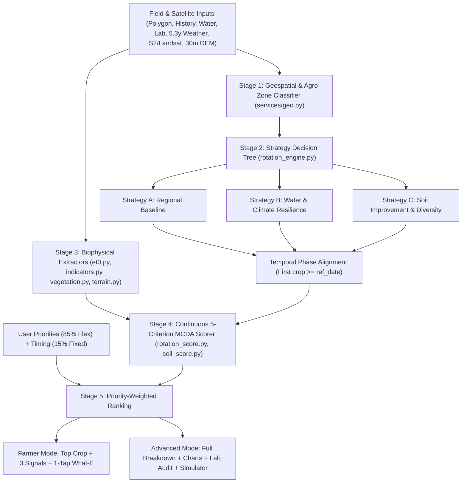
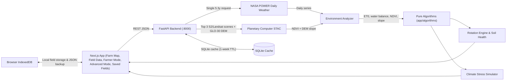
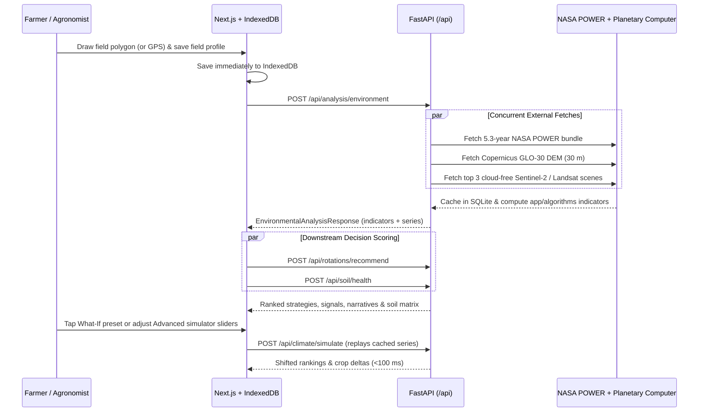

# ROTARA

**Crop rotation and soil intelligence for Punjab, Pakistan.**


<br/>

ROTARA helps farmers and extension-office agronomists in Punjab decide what crop to plant next on a mapped field. It pulls daily satellite weather, optical vegetation imagery, and 30 m terrain elevation data, combines them with crop history and optional soil lab measurements, and runs everything through one scoring engine.

The application opens into two synchronized views built on top of the exact same calculations:

- Farmer Mode gives a straightforward answer: which crop to sow next, when to plant it, three color-coded risk checks, and simple weather stress buttons.
- Advanced Mode gives agronomists the full breakdown: criterion weights, raw biophysical charts, FAO-56 water balance numbers, laboratory vs. satellite provenance, and a continuous climate simulator.

---

<br/>

## The Inputs Behind Every Recommendation

Evaluating a single field requires pulling together several disconnected data streams. ROTARA collects and normalizes seven categories of input before scoring any crop rotation:

| Input Source | What Is Collected | Module |
| --- | --- | --- |
| Field boundary | GeoJSON polygon corners, geodesic area in hectares/acres/kanals, perimeter, centroid | `backend/app/services/geo.py` |
| 5.3-year daily weather | ~1,935 days of `T2M`, `T2M_MAX`, `T2M_MIN`, `PRECTOTCORR`, `ALLSKY_SFC_SW_DWN`, `RH2M`, `WS2M` | `backend/app/services/nasa/power.py` |
| Optical satellite scenes | Cloud-filtered Sentinel-2 L2A (10 m) and Landsat Collection 2 L2 (30 m) Red, NIR, and SWIR bands | `backend/app/services/nasa/planetary_computer.py` |
| Terrain elevation | Copernicus GLO-30 DEM (30 m) height raster and pixel-level slope gradients | `backend/app/algorithms/terrain.py` |
| Field and water intake | Standing crop, previous crop, fallow state, irrigation method, water supply reliability | `frontend/src/components/intake/DataIntakeView.tsx` |
| Soil lab test (optional) | Measured pH, organic matter percentage, electrical conductivity (`EC`), salinity, NPK, texture | `backend/app/models/schemas.py` |
| Priority settings | Four weights for water conservation, soil health, climate resilience, and mandi demand | `backend/app/algorithms/rotation_score.py` |

<br/>

---

<br/>

## Two Views Built on One Engine

Both modes read from the same backend responses (`EnvironmentalAnalysisResponse`, `RotationResponse`, `SoilHealthResponse`, and `ClimateSimulationResponse`). Every module produces plain-language farmer text alongside technical notes for agronomists so the advice stays consistent across views.

<br/>

### How Farmer Mode Simplifies the Data


In `frontend/src/components/advice/AdviceView.tsx`, dense satellite arrays and scoring matrices are compressed into four parts a farmer can read at a glance.

#### 1. One top crop recommendation

The highest-scoring strategy appears at the top with a crop illustration, local Urdu/Punjabi name (`Gandam`, `Chawal`, `Kapas`, `Moong`), overall score out of 100, and exact sowing and harvest months.

#### 2. Traffic-light condition checks

Continuous scores across water fit, heat fit, and soil strength map to three states in `frontend/src/components/ui/Signal.tsx`:

- `Good condition` for scores of `70` and above
- `Needs attention` for scores from `45` to `69.9`
- `High risk` for scores below `45`

#### 3. Plain-language reasons

Every strategy carries `farmer_reason` and `farmer_next_step` strings explaining why the crop fits the field's water supply and what to prepare next.

#### 4. One-tap goals and weather tests

Farmers can switch priorities with four buttons (`Save Water`, `Build Soil Health`, `Beat Heat & Dry Spells`, `Mandi Demand`) or test three preset shocks (`30% Less Rain`, `+2 C Hotter Season`, `Canal Water Shortage`) to see if their top crop changes.

<br/>

### How Advanced Mode Surfaces Full Agronomic Detail


In `frontend/src/components/expert/ExpertDetailsView.tsx`, agronomists can inspect every underlying number across four structured sections.

#### 1. Multi-Criteria Crop Rotation Recommendations (`CropRotationsView.tsx`)

Displays all three competing 4-season strategies side by side. Each strategy exposes its five criterion scores, normalized priority weights, weighted point contributions, evidence strings, benefit/risk lists, and the 12-crop Punjab seasonal calendar. Continuous `1-5` sliders recalculate rankings in real time.

#### 2. Soil Health and Laboratory Diagnostics (`SoilHealthView.tsx`)

Separates `Measured Lab Test` entries (pH, SOM %, EC) from `Field History` (same-family succession, legume presence, fallow duration) and `Satellite / Derived` proxies (moisture status, bare-soil exposure, slope runoff). Whenever lab data is missing, the UI prints `cannot_conclude_without_lab` warnings to state that satellites cannot measure pH, organic matter, salinity, or NPK.

#### 3. Earth Observations and Biophysical Indicators (`FieldAnalysisView.tsx`)

Plots daily `Rainfall vs. FAO-56 ET0`, temperature curves, and optical NDVI observations. It lists 30-day and 90-day rainfall totals, 5-year same-month rainfall anomalies, maximum dry spells, `>= 38 C` heat-stress days, `<= 4 C` cold days, mean DEM slope, dataset availability, and known scientific limits.

#### 4. Parametric Climate Stress Simulator (`ClimateSimulatorView.tsx`)

Provides continuous sliders for rainfall change (`%`), temperature increase (`+C`), and water-availability overrides. The backend replays the stored daily weather record under those shifts and returns `baseline_score` vs. `simulated_score`, strategy rank changes, and per-crop suitability deltas.

<br/>

---

<br/>

## How the Decision Tree and Scoring Algorithm Were Built

ROTARA uses a deterministic rule-structured decision tree paired with a continuous Multi-Criteria Decision Analysis (MCDA) scorer. We built it this way so extension officers can trace every point in a recommendation back to a physical measurement or crop rule, even when soil lab results are absent or clouds block recent satellite passes.

<br/>



<br/>

### Stage 1: Agro-Ecological Zone Branching (`services/geo.py`)

First, `analyze_field_geometry` computes the WGS84 geodesic area and centroid of the drawn polygon. `classify_punjab_agro_zone` then places the field into one of five Punjab cropping zones using latitude and longitude boundaries:

| Zone ID | Spatial Envelope | Agronomic Profile |
| --- | --- | --- |
| `barani_potohar` | `lat >= 32.5` | Sloping rainfed and limited-irrigation belt; drought-hardy pulses and moisture retention dominate |
| `rice_wheat` | `lat >= 31.1, lon >= 73.2` | Northeastern irrigated plains prone to subsurface hardpans and groundwater decline |
| `cotton_wheat` | `lat < 30.8, lon >= 71.0` | Hot southern plains where summer heat tolerance and canal timing drive crop survival |
| `thal_sandy` | `lon < 72.1, 30.3 <= lat < 32.5` | Fast-draining western sandy soils suited to chickpea, mung bean, and millet |
| `central_mixed` | Remaining central plains | Canal-irrigated plains supporting maize, wheat, sugarcane, and spring catch crops |

<br/>

### Stage 2: Candidate Sequence Decision Tree (`services/crops/rotation_engine.py`)

Testing every permutation of 12 crops over 4 seasons creates 20,736 combinations, most of which violate Rabi, Kharif, and Zaid planting calendars. To keep sequences agronomically valid and easy to compare, `_pick_zone_sequences` branches on `(zone_id, current_crop, previous_crop, water_availability, moisture_proxy_status)` to build three contrasting 4-season archetypes:

1. Strategy A (`Existing Rotation / Baseline`) selects the standard regional pattern around the field's standing or previous crop (`wheat-rice`, `wheat-cotton`, `wheat-sorghum_millet`, `chickpea-sorghum_millet`, `sugarcane-wheat-maize-wheat`, or `wheat-maize`).
2. Strategy B (`Water & Climate Resilience`) switches to low-water, heat-tolerant crops (`chickpea`, `sorghum_millet`, `mustard`, `mung_bean`) when the field sits in `barani_potohar` or `thal_sandy`, has `limited` or `scarce` irrigation, or shows a `very_dry` water balance.
3. Strategy C (`Soil Improvement & Diversity`) inserts nitrogen-fixing legumes and short Zaid cover or green-manure crops (`dhaincha`, `mung_bean`, `berseem`, `chickpea`, `lentil`) tailored to break local cereal or fiber monocultures.

After selecting the three sequences, the `align` helper cyclically rotates each 4-crop list so `Season 1` lands on the earliest planting month on or after `ref_date`. If the field is currently fallow, `align` skips past an immediate non-legume repeat of `previous_crop` so the farmer is not advised to replant the exact crop they just harvested.

<br/>

### Stage 3: Biophysical Feature Extraction (`backend/app/algorithms/`)

All physical equations live as pure stateless functions in `backend/app/algorithms/`.

#### FAO-56 Penman-Monteith Reference Evapotranspiration (`et0.py`)

Runs on daily NASA POWER weather (`T2M`, `T2M_MAX`, `T2M_MIN`, `ALLSKY_SFC_SW_DWN`, `RH2M`, `WS2M` floored at `0.2 m/s`) using the field's mean DEM elevation `z` (default `180.0 m`):

```text
P     = 101.3 * ((293 - 0.0065 * z) / 293)^5.26          [atmospheric pressure, kPa]
gamma = 0.000665 * P                                      [psychrometric constant]
e0(T) = 0.6108 * exp(17.27 * T / (T + 237.3))             [Tetens vapor pressure, kPa]
es    = (e0(Tmax) + e0(Tmin)) / 2
ea    = es * clamp(RH / 100, 0.05, 1.0)
Rn    = max(0, 0.77*Rs - 4.903e-9 * ((Tmax_K^4 + Tmin_K^4)/2) * (0.34 - 0.14*sqrt(ea)) * 0.55)
ET0   = (0.408*delta*Rn + gamma*(900/(Tmean+273))*u2*(es-ea)) / (delta + gamma*(1 + 0.34*u2))
```

#### 5.3-Year Weather Aggregation (`indicators.py`)

Splits one 5.3-year NASA POWER pull locally into the recent 90-day and 30-day windows alongside up to 5 prior same-month baseline windows.

- 30-day net water balance (`rain_30 - et0_30`) maps to `wet` (`>= +10 mm`), `adequate` (`>= -65 mm`), `dry` (`>= -120 mm`), or `very_dry` (`< -120 mm`).
- Rainfall anomaly percentage compares 30-day rainfall against the 5-year baseline (`((rain_30 - baseline_30) / baseline_30) * 100`) whenever `baseline_30 >= 5.0 mm`.
- Thermal counts track 90-day heat-stress days (`Tmax >= 38.0 C`), cold days (`Tmin <= 4.0 C`), and longest dry spell (`rain < 1.0 mm/day`).

#### Optical Vegetation and Bare-Soil Fraction (`vegetation.py`)

Queries Sentinel-2 L2A (10 m, top 3 scenes under 15% cloud cover, fallback `< 30%`) and queries Landsat Collection 2 L2 (30 m) only when fewer than 2 Sentinel-2 scenes pass filtering. It computes mean `NDVI = (NIR - Red) / (NIR + Red)` over valid pixels (`>= 0.55` vigorous, `>= 0.32` moderate, `>= 0.18` stressed, `< 0.18` bare or fallow) and estimates exposed soil via `clamp((0.35 - NDVI) / 0.25, 0, 1)` when `NDVI < 0.35`.

#### Terrain Slope and Runoff Risk (`terrain.py`)

Computes finite differences over the Copernicus GLO-30 DEM (`slope(%) = sqrt((dz/dx)^2 + (dz/dy)^2) * 100`) and classifies mean slope into `low` (`< 2.0%`), `moderate` (`2.0%` to `6.0%`), or `high` (`>= 6.0%`) erosion susceptibility.

<br/>

### Stage 4: Continuous Multi-Criteria Scoring (`rotation_score.py` & `soil_score.py`)

Hard threshold rules create sharp score jumps when weather sits near a boundary. To avoid cliff effects, each candidate sequence is scored continuously across five criteria.

#### Water Conservation and Moisture Fit (`15` to `100`)

Starts from crop water demand (`low: 94`, `moderate: 76`, `high: 52`, `very_high: 32`), adjusts for irrigation supply (`abundant` grants `+20` relief to thirsty crops while `scarce` subtracts `6-28` points), and subtracts continuous dryness stress weighted by drought tolerance:

```text
dryness_stress = 0.75 * clamp(-rain_anom_pct / 50, 0, 1.6) + 0.45 * clamp(-wb_30 / 150, 0, 1.2)
score -= DRYNESS_SENSITIVITY[demand] * (0.70 if high_drought_tolerance else 1.0) * dryness_stress
```

A single fallow season before planting adds `+2.5` points for conserved root-zone moisture.

#### Climate, Heat, and Terrain Fit (`15` to `100`)

Begins at `84` inside suitable agro-zones (`58` outside), then subtracts heat-day penalties (`min(20, heat_days * 0.65) * heat_factor`), 30-day `Tmax` excess above crop optimum (`* 2.8`) and `28 C` ambient baseline (`* 1.4`), plus `-16` points for paddy rice on slopes `>= 3.0%`.

#### Soil Health and Diversity (`15` to `100`)

Rewards unique botanical families (`F`), root-depth classes (`R`), nitrogen fixers (`N`), and high organic-matter crops (`O`), while penalizing back-to-back same-family crops (`P_same`), continuous bare fallow without cover crops, or low lab organic matter (`< 0.8%`) with zero legumes:

```text
S_soil = 40 + min(24, 8*F) + min(15, 5*R) + min(18, 9*N) + min(8, 4*O) - 8*P_same + history_adjustments
```

#### Local Mandi Market Demand (`0` to `100`)

Averages Punjab crop demand (`moderate: 68`, `high: 84`, `very_high: 94`).

#### Current Planting Window Fit (`70` to `95`, up to `98` when fallow)

Scores `95` when `Season 1` planting is open in `ref_date.month`, `85` for the upcoming season, and `70` otherwise, adding `+4` points (capped at `98`) if the field is currently fallow and ready for seedbed preparation.

<br/>

### Stage 5: Priority Normalization and Stress Replay (`scenario.py`, `climate_sim.py`)

`compute_priority_weights` normalizes the four user sliders (`water_conservation`, `climate_resilience`, `soil_improvement`, `market_suitability`) to sum to `85%` of the final score while locking `Current Planting Window Fit` at `15%`. Keeping timing fixed at `15%` prevents priority sliders from pushing an out-of-season crop to the top.

During climate stress simulations, rainfall anomalies scale multiplicatively (`new_anomaly = (max(0, (1 + existing/100) * (1 + delta/100)) - 1) * 100`), and every daily weather row is replayed through `compute_fao56_et0` so 30-day water balance and `>= 38 C` heat-stress days stay physically consistent.

<br/>

---

<br/>

## System Architecture



<br/>

### Runtime Request Sequence



<br/>

---

<br/>

## Quick Start and Commands

Requirements: Python 3.12+ and Node.js 20+ with `pnpm`.

Run all commands from the repository root (`ROTARA/`):

| Task | `pnpm` command | Windows PowerShell shortcut |
| --- | --- | --- |
| Install Python venv + frontend dependencies | `pnpm run setup` | `.\rotara.ps1 setup` |
| Run backend tests (`pytest`) + frontend lint | `pnpm test` | `.\rotara.ps1 test` |
| Build production frontend bundle | `pnpm build` | `.\rotara.ps1 build` |
| Start FastAPI (`:8000`) + Next.js (`:3000`) | `pnpm start` | `.\rotara.ps1 start` |
| Run development servers with hot reload | `pnpm dev` | `.\rotara.ps1 dev` |

### Production Configuration

Set `CORS_ORIGINS` to a JSON list of deployed frontend origins, such as `["https://rotara.example"]`; wildcard origins are rejected. Keep `backend/.env` local and never commit credentials or runtime SQLite cache files. The cache-clear endpoint is disabled by default and should stay protected by the deployment gateway if enabled.

<br/>

---

<br/>

## Repository Structure

```text
ROTARA/
├── scripts/rotara.mjs              # Unified setup, test, build, dev, start runner
├── rotara.ps1                      # PowerShell wrapper adding Node path on Windows
├── backend/
│   ├── app/
│   │   ├── main.py                 # FastAPI endpoints & CORS/health configuration
│   │   ├── algorithms/             # Pure stateless equations & MCDA scoring math
│   │   │   ├── et0.py              # FAO-56 Penman-Monteith reference ET0
│   │   │   ├── vegetation.py       # NDVI/NDWI, bare soil fraction, canopy status
│   │   │   ├── terrain.py          # DEM slope % and runoff/erosion class
│   │   │   ├── indicators.py       # 30d/90d rain anomaly, heat/frost days, P - ET0
│   │   │   ├── rotation_score.py   # Continuous water, climate, market, timing & weights
│   │   │   ├── soil_score.py       # Sequence biodiversity score & lab thresholds
│   │   │   ├── scenario.py         # Multiplicative rain anomaly & daily series shifting
│   │   │   └── climate_events.py   # Date-bounded weather shock transformations
│   │   ├── cache/store.py          # Thread-safe SQLite response cache with TTL support
│   │   ├── models/schemas.py       # Pydantic request/response contracts & validators
│   │   └── services/
│   │       ├── geo.py              # WGS84 geodesy & 5-zone Punjab classifier
│   │       ├── analysis/           # environment.py, soil_health.py, climate_sim.py
│   │       ├── crops/              # punjab_data.py (12 crops), rotation_engine.py
│   │       └── nasa/               # power.py, planetary_computer.py
│   └── tests/                      # Algorithm, endpoint, and validation tests
└── frontend/
    ├── public/crops/               # 12 crop PNG illustrations (wheat, rice, cotton, ...)
    └── src/
        ├── hooks/useFieldPipeline.ts
        └── components/
            ├── RotaraApp.tsx       # 5-tab workspace (Map, Field Data, Farmer, Advanced, Saved)
            ├── map/                # FarmMapCanvas.tsx, mapOverlays.ts
            ├── intake/             # DataIntakeView.tsx
            ├── fields/             # FieldRegistrationModal.tsx, MyFieldsView.tsx
            ├── advice/             # AdviceView.tsx (Farmer Mode)
            ├── expert/             # ExpertDetailsView.tsx (4-tier Agronomist Mode)
            ├── analysis/           # FieldAnalysisView.tsx
            ├── rotations/          # CropRotationsView.tsx
            ├── soil/               # SoilHealthView.tsx
            ├── simulator/          # ClimateSimulatorView.tsx
            └── ui/                 # CropImage.tsx, Signal.tsx, primitives.tsx
```

<br/>

---

<br/>

## Data Sources and Known Limitations

- The NASA POWER API (`0.5 deg x 0.625 deg`, ~55 km grid) captures regional weather patterns and 5-year baselines; it does not reflect single-field microclimates or unrecorded canal and tubewell irrigations. Responses are cached weekly per rounded coordinate.
- Microsoft Planetary Computer STAC supplies public Sentinel-2 L2A (10 m), Landsat Collection 2 L2 (30 m), and Copernicus GLO-30 DEM (30 m) rasters with no API keys. Persistent monsoon cloud cover can delay recent optical NDVI updates.
- Satellites measure canopy greenness and ground slope; soil pH, electrical conductivity, organic matter percentage, and NPK levels require a laboratory soil test. When no lab sheet is provided, ROTARA reports soil chemistry as unknown instead of guessing values.
- Suitability scores (`0-100`) compare environmental and agronomic fit across candidate rotations; they are not yield guarantees and do not model pest outbreaks or mandi price swings.
- Field boundaries and profiles are saved locally in browser `IndexedDB`. Use Backup / Restore (`rotara-fields-v1` JSON) in **Saved Fields** to move records between extension computers.
