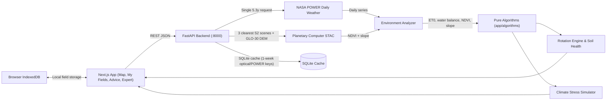
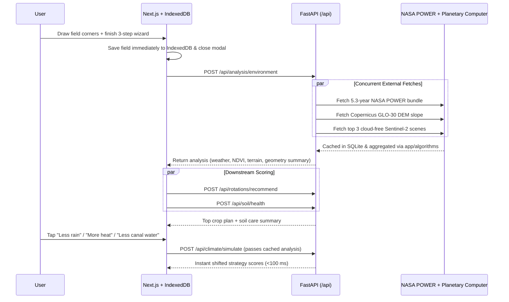

# ROTARA: Punjab Crop Rotation & Soil Helper

ROTARA helps extension-office agronomists and farmers in Punjab choose the next best crop rotation for a mapped field. It combines live satellite greenness, 30 m terrain slope, and daily NASA weather with a Punjab crop catalog and simple picture-first screens (`Map`, `My Fields`, `Advice`, and `Expert details`).

---

## Quick Start & Unified Commands

All commands run from the repository root (`ROTARA/`):

| Task | pnpm command | Windows PowerShell shortcut |
| --- | --- | --- |
| Install Python venv + frontend dependencies | `pnpm run setup` | `.\rotara.ps1 setup` |
| Run backend tests (`pytest`) + frontend lint | `pnpm test` | `.\rotara.ps1 test` |
| Build production frontend bundle | `pnpm build` | `.\rotara.ps1 build` |
| Start FastAPI (`:8000`) + Next.js (`:3000`) | `pnpm start` | `.\rotara.ps1 start` |
| Run development servers with hot reload | `pnpm dev` | `.\rotara.ps1 dev` |

Requirements: Python 3.12+ and Node.js 20+ with `pnpm`.

---

## Using the App (Farmer Screens)

The sidebar has 4 screens designed for use alongside farmers at an extension desk:

1. **Map**:
   - Tap **Draw Field on Map** and click each corner (double-click zoom turns off while drawing). Click the green first dot or press **Done** to finish.
   - Or tap **Use My GPS Location** to create a plot around your current position.
   - Switch between 3 high-contrast map views: **Outline**, **Plant health**, and **Water stress**.
   - Saving a field in the 3-step picture wizard closes the dialog right away while satellite data downloads in the background.
2. **My Fields**:
   - Visual cards with crop illustrations and size in both **acres** and **kanals**.
   - **Open Field** loads advice; **Edit** or **Delete** updates local storage; **Backup** / **Restore** saves or loads `rotara-fields-v1` JSON files.
3. **Advice**:
   - Shows **"Plant THIS next"** with crop illustration, sowing window, and 3 clear traffic-light signals (**Good**, **Careful**, **Risky**) for Water Fit, Heat Fit, and Soil Fit.
   - Lists the following crop (**"Then plant after harvest"**), 3 plain **"Why this crop?"** reasons, soil care guidance, and 3 one-tap **"What if?"** weather stress buttons (**Less rain**, **More heat**, **Less canal water**).
4. **Expert details**:
   - Full charts (`Rainfall vs ET0`, daily temperature, NDVI series), all 3 rotation strategies with priority weight sliders, crop calendar table, soil lab dimensions, and continuous scenario sliders.

---

## How It Works

### System Architecture



### Runtime Request Flow



---

## Folder Map

```text
ROTARA/
├── scripts/rotara.mjs              # Unified setup, test, build, dev, start runner
├── rotara.ps1                      # PowerShell wrapper adding Node path on Windows
├── backend/
│   ├── app/
│   │   ├── algorithms/             # Pure stateless equations & scoring math
│   │   │   ├── et0.py              # FAO-56 Penman-Monteith reference ET0
│   │   │   ├── vegetation.py       # NDVI/NDWI, bare soil fraction, canopy status
│   │   │   ├── terrain.py          # DEM slope % and runoff/erosion class
│   │   │   ├── indicators.py       # 30d/90d rain anomaly, heat/frost days, P - ET0
│   │   │   ├── rotation_score.py   # Continuous water, heat, market & timing scores
│   │   │   ├── soil_score.py       # Sequence biodiversity score & lab thresholds
│   │   │   └── scenario.py         # Multiplicative rain anomaly & series shifting
│   │   ├── cache/store.py          # Thread-safe SQLite response cache with TTL support
│   │   ├── models/schemas.py       # Pydantic request/response contracts & validators
│   │   └── services/
│   │       ├── analysis/           # environment.py, soil_health.py, climate_sim.py
│   │       ├── crops/              # punjab_data.py (12 crops), rotation_engine.py
│   │       └── nasa/               # power.py, planetary_computer.py
│   └── tests/test_rotara.py        # Algorithm, endpoint, and validation tests
└── frontend/
    ├── public/crops/               # 12 crop PNG illustrations (wheat, rice, cotton, ...)
    └── src/
        ├── hooks/useFieldPipeline.ts
        └── components/
            ├── map/                # FarmMapCanvas.tsx, mapOverlays.ts
            ├── fields/             # FieldRegistrationModal.tsx, MyFieldsView.tsx
            ├── advice/             # AdviceView.tsx
            ├── expert/             # ExpertDetailsView.tsx (+ analysis, rotations, soil, simulator)
            └── ui/                 # CropImage.tsx, Signal.tsx, primitives.tsx
```

---

## Algorithms & Equations (`backend/app/algorithms/`)

All agronomic formulas live as pure functions in `backend/app/algorithms/` with named constants.

### 1. Reference Evapotranspiration (`et0.py`)

Uses daily NASA POWER meteorology (`T2M`, `T2M_MAX`, `T2M_MIN`, `ALLSKY_SFC_SW_DWN`, `RH2M`, `WS2M`) and mean DEM elevation `z` (default `180.0 m`):

```text
P     = 101.3 * ((293 - 0.0065 * z) / 293)^5.26          [atmospheric pressure, kPa]
gamma = 0.000665 * P                                      [psychrometric constant]
e0(T) = 0.6108 * exp(17.27 * T / (T + 237.3))             [Tetens vapor pressure, kPa]
es    = (e0(Tmax) + e0(Tmin)) / 2
ea    = es * clamp(RH / 100, 0.05, 1.0)
Rn    = max(0, 0.77*Rs - 4.903e-9 * ((Tmax_K^4 + Tmin_K^4)/2) * (0.34 - 0.14*sqrt(ea)) * 0.55)
ET0   = (0.408*delta*Rn + gamma*(900/(Tmean+273))*u2*(es-ea)) / (delta + gamma*(1 + 0.34*u2))
```

Wind speed `u2` is floored at `0.2 m/s` to avoid stagnant-air blowups.

### 2. Satellite Vegetation (`vegetation.py`)

- **Normalized Difference**: `NDVI = mean((NIR - Red) / (NIR + Red))` over valid pixels where `NIR + Red > 0` and `-1 <= ratio <= 1`.
- **Bare Soil Fraction**: When `NDVI < 0.35`, `bare_fraction = clamp((0.35 - NDVI) / 0.25, 0, 1)`, calibrated for Punjab alluvial soils (bare near `0.10`, canopy closure near `0.35`).
- **Status thresholds**: `>= 0.55` vigorous, `>= 0.32` moderate, `>= 0.18` stressed, `< 0.18` bare or fallow.
- Optical pipeline prefers Sentinel-2 L2A (10 m, top 3 clearest scenes under 15% cloud cover, fallback `< 30%`) and only queries Landsat Collection 2 L2 (30 m) if fewer than 2 Sentinel-2 scenes are found.

### 3. Terrain Slope (`terrain.py`)

From Copernicus GLO-30 DEM (30 m):

```text
slope(%) = sqrt((dz/dx)^2 + (dz/dy)^2) * 100
```

Mean slope `< 2.0%` is `low` runoff/erosion risk, `2.0%` to `6.0%` is `moderate`, and `>= 6.0%` is `high`.

### 4. Weather Aggregation (`indicators.py`)

- **Recent windows**: 30-day and 90-day rainfall (`PRECTOTCORR`), 30-day `ET0`, and `water_balance_30d = rain_30 - et0_30`.
- **Baseline comparison**: One 5.3-year NASA POWER request is split locally into the last 90 days plus up to 5 prior same-month baseline windows (`rain_anomaly_pct = ((rain_30 - baseline_30) / baseline_30) * 100` when `baseline_30 >= 5.0 mm`).
- **Moisture classes (`rain_30 - et0_30`)**: `>= +10 mm` wet, `>= -65 mm` adequate, `>= -120 mm` dry, `< -120 mm` very dry.
- **Thermal counts**: `heat_stress_days_90d` counts days with `Tmax >= 38.0 C`; `frost_risk_days_90d` counts days with `Tmin <= 4.0 C`.

### 5. Continuous Rotation Scoring (`rotation_score.py` & `soil_score.py`)

Each 3-step crop strategy is scored across 5 criteria and combined using normalized user weights (4 flexible priorities sum to `85%`, planting-window timing is fixed at `15%`):

1. **Water Match (15 to 100)**:
   - Starts from crop demand baseline (`low: 94`, `moderate: 76`, `high: 52`, `very_high: 32`).
   - Adjusts continuously for irrigation supply (`abundant: -1.0` pressure giving `+20` relief to thirsty crops up to `scarce: +1.0` pressure subtracting `6..28` pts) and continuous dryness stress:
     ```text
     dryness_stress = 0.75 * clamp(-rain_anom_pct / 50, 0, 1.6) + 0.45 * clamp(-wb_30 / 150, 0, 1.2)
     score -= DRYNESS_SENSITIVITY[demand] * (0.70 if high_drought_tolerance else 1.0) * dryness_stress
     ```
2. **Heat & Climate Match (15 to 100)**:
   - Zone suitability (`84` in zone, `58` outside), minus continuous penalties for heat stress days (`min(20, heat_days * 0.65) * heat_factor`) and 30-day maximum temperature excess above crop optimum (`* 2.8`) and `28 C` ambient threshold (`* 1.4`), plus `-16` pts for rice on `>= 3.0%` slopes.
3. **Soil Health (15 to 100)**:
   ```text
   S_soil = 40 + min(24, 8*F) + min(15, 5*R) + min(18, 9*N) + min(8, 4*O) - 8*P_same (- 8 if low OM and N=0)
   ```
   where `F` = unique botanical families, `R` = root depths, `N` = legumes (`nitrogen_fixer`), `O` = high organic-matter crops, `P_same` = adjacent same-family repeats.
4. **Market Demand (0 to 100)**: Average Punjab demand score (`moderate: 68`, `high: 84`, `very_high: 94`).
5. **Planting Window (70 to 95)**: `95` if planting is open in `ref_date`'s month, `85` if upcoming season, `70` otherwise.

### 6. Climate & Water Stress Simulation (`scenario.py`)

- Multiplicative rainfall anomaly adjustment (never additive):
  ```text
  new_anomaly(%) = (max(0, (1 + existing_anomaly/100) * (1 + delta_pct/100)) - 1) * 100
  ```
- Replays every daily observation with `rain * factor` and `temp + delta_C`, recomputing daily FAO-56 ET0, 30-day water balance, mean `Tmax`, and 90-day heat-stress days. If daily weather rows are absent, applies monotonic fallback shifts so all three scenario sliders (`rainfall_change_pct`, `temp_increase_c`, `water_availability_override`) affect strategy rankings consistently.

---

## Data Sources & Known Limitations

- **NASA POWER API**: ~0.5 deg x 0.625 deg (~55 km) regional grid; captures weather patterns, not single-field microclimates. Cached weekly per rounded coordinate.
- **Microsoft Planetary Computer STAC**: Public Sentinel-2 L2A (10 m) and Landsat Collection 2 L2 (30 m) NDVI + Copernicus GLO-30 DEM (30 m); requires no API keys. Persistent overcast periods limit recent NDVI.
- **Soil Laboratory Uncertainty**: Satellites do not measure soil pH, electrical conductivity, or NPK. Without an optional lab sheet, ROTARA explicitly reports lab soil fertility as unknown rather than guessing values.
- **Local Storage**: Field records live in browser `IndexedDB`; use **Backup** in **My Fields** to copy fields between extension computers.
